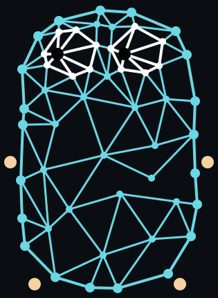

# Gonnect

**Gonnect** is a collection of network helper functions and common types that
have been reinvented and reimplemented countless times in many Go projects.
I created it mostly for myself, but feel free to use it in your projects or 
[suggest features](https://github.com/asciimoth/gonnect/issues/new).

## Routing rules

The `routing` subpackage provides bytecode based routing rules for
`gonnect.Router`, `gonnect/tun.Splitter`, and `gonnect/sniffer.Sniffer`.
Rules can be built directly from bytecode or parsed from a small text format.
See [`routing/README.md`](routing/README.md) for examples.

## Mesh DNS names

The `dns/meshnames` subpackage provides a `gonnect.Resolver` implementation
for mesh-oriented DNS names (`.meshname`, `.meship`, `.ygg`, and `.pk.ygg`).
See [`dns/meshnames/README.md`](dns/meshnames/README.md) for examples.

## Related projects

These active projects use Gonnect directly or through another project:

- [almagest](https://github.com/asciimoth/almagest) - visual network toolkit built from Gonnect-based networking components
- [batchudp](https://github.com/asciimoth/batchudp) - UDP transport package with Gonnect network support
- [gonnect-netstack](https://github.com/asciimoth/gonnect-netstack) - gVisor userspace TCP/IP stack integration
- [gonnect-vpn-example](https://github.com/asciimoth/gonnect-vpn-example) - point-to-point VPN example
- [killswitch](https://github.com/asciimoth/killswitch) - Linux eBPF network kill switch and proxy
- [mnlib](https://github.com/asciimoth/mnlib) - mesh-oriented DNS name resolution through a Gonnect network
- [pasta](https://github.com/asciimoth/pasta) - node-based framework with a Gonnect-based demo backend
- [socksgo](https://github.com/asciimoth/socksgo) - SOCKS client and server library
- [sysnet-linux](https://github.com/asciimoth/sysnet-linux) - Linux backend for `gonnect/sysnet`
- [sysnet-windows](https://github.com/asciimoth/sysnet-windows) - Windows backend for `gonnect/sysnet`
- [tor-driver](https://github.com/asciimoth/tor-driver) - Tor client and onion services through Gonnect networks
- [tuntap](https://github.com/asciimoth/tuntap) - cross-platform TUN device library
- [wg-web-demo](https://github.com/asciimoth/wg-web-demo) - browser demo of HTTP over WireGuard and SOCKS-over-WebSocket
- [wgo](https://github.com/asciimoth/wgo) - WireGuard library built on Gonnect networking components
- [wgo-tailscale](https://github.com/asciimoth/wgo-tailscale) - Tailscale-compatible control plane for `wgo`
- [ygg](https://github.com/asciimoth/ygg) - Yggdrasil mesh network implementation with [WASM builds](https://asciimoth.github.io/ygg/)

## License
Files in this repository are distributed under the CC0 license.  

  
   
  To the extent possible under law,
  <a rel="dct:publisher"
     href="https://github.com/asciimoth">
    ASCIIMoth</a>
  has waived all copyright and related or neighboring rights to
  gonnect.

